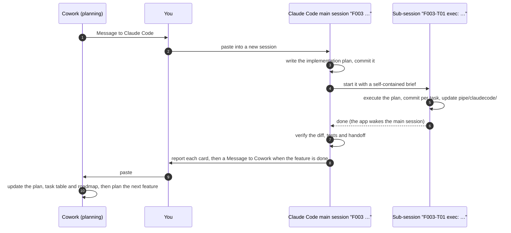

# claude-relay-loop

**A project scaffold for working with two Claude layers: Cowork plans, Claude Code builds, and you relay one short message each way per feature.**

> Community project, not made, endorsed or supported by Anthropic. Claude, Claude Code and Cowork are Anthropic products.

## Why

Long AI sessions forget. Planning and coding in the same chat buries decisions under tool output. Copy-pasting context between tools is tedious and loses things.

claude-relay-loop splits the work:

- **Cowork** (the planning layer) talks scope with you, writes feature plans and task cards, and reads the results.
- **Claude Code** (the implementation layer) turns a task card into an implementation plan in a **main session**, executes it in a **sub-session**, and verifies the result before reporting to you.
- **You** decide, and relay one message each way per feature.

Everything that matters lives in files (`pipe/`, `features/`, `roadmap.md`), so any session can be replaced by a fresh one without losing context.

## The loop



One loop per feature (`F001`, `F002`, …). Session titles start with the F number, so a feature's main session and its sub-sessions sit together in the sidebar.

## What you get

```
my-project/
├── COWORK.md            # rules for the planning layer (Cowork reads it at the start of every session)
├── CLAUDE.md            # rules for the implementation layer (Claude Code loads it automatically)
├── roadmap.md           # goal, users, current focus, next, later
├── features/
│   ├── README.md        # F numbers and how features are organized
│   └── _template/plan.md
└── pipe/                # the handoff area
    ├── README.md        # how the handoff works, and the two message formats
    ├── cowork/          # latest.md (state, task table, task cards) and log/
    └── claudecode/      # latest.md, log/ and plans/
```

Your code goes wherever you like. Cowork edits only the planning files; Claude Code edits the code and `pipe/claudecode/`.

## Requirements

- The **Claude desktop app** with Cowork and Claude Code (the Code tab). Starting a sub-session from the main session needs the desktop app.
- The **Claude Code CLI or an IDE extension** also works: the main session prints the sub-session's brief, and you paste it into a second session yourself.
- `bash` 3.2 or later, `git` and `perl` for `init.sh`. They come with macOS and most Linux distributions. `jq` only for `--auto-push`.
- Optional: the superpowers plugin for Claude Code. The rules use its planning and execution skills when it's installed, and a plain plan skeleton when it isn't.

## Quick start

```bash
git clone https://github.com/TwilightVoyager777/claude-relay-loop.git
claude-relay-loop/init.sh ~/code/my-project --name "My Project"
```

1. Open Cowork on `~/code/my-project` and say: **Read COWORK.md and onboard me.**
   Cowork asks a few questions, writes the roadmap, the first feature plan and the first task card, and gives you a **Message to Claude Code**.
2. In the Claude desktop app, open the Code tab on the same folder, start a new session, and paste the message.
   That session renames itself `F001 …`, writes the plan, starts the sub-session, and verifies the result.
3. When the feature is done, it gives you a **Message to Cowork**. Paste it into Cowork, and the loop starts again.

[docs/the-loop.md](docs/the-loop.md) walks through one full feature with example messages.

### Existing projects

Run the same command on the project's folder. `init.sh` never overwrites a file: anything that already exists, such as your own `CLAUDE.md`, is skipped and listed together with the scaffold's copy to merge from by hand. Try `--dry-run` first to see what would happen.

## Options

| Option | What it does |
|---|---|
| `--name "My Project"` | Project name used in the generated files (default: the folder name) |
| `--team` | Adds the team add-on: a shared `CLAUDE.md` for teammates (branch + pull request), your own loop rules in `CLAUDE.local.md` (git-ignored), `TEAM.md` for Cowork, a task-card template and a pull request template |
| `--no-attribution` | Writes `.claude/settings.json` that turns off AI attribution in commits and pull requests |
| `--auto-push` | Adds a hook that pushes the current branch after every commit Claude Code makes (needs `jq`) |
| `--dry-run` | Shows what would be created or skipped, and writes nothing |

More in [docs/customizing.md](docs/customizing.md).

## FAQ

**Why not let Cowork and Claude Code talk to each other directly?**
You stay in control of every handoff, and it costs two short pastes per feature. The files are the source of truth, so either side can start a fresh session whenever one gets long.

**Why a main session and a sub-session?**
Writing a plan and executing it each produce a lot of context; keeping them apart means neither crowds out the other. The main session didn't write the code, so it reviews the result with fresh eyes. And the sub-session is a real session: you can open it, watch it, and talk to it.

**Do I have to use Cowork?**
The rules are written for Cowork. Another planning chat that can read and write the project folder could follow `COWORK.md` too, but only Cowork has been used in practice.

**Which language?**
The rule files are in English. Both layers reply in whatever language you write to them in, and Cowork can write your project files in another language if you ask during onboarding.

**Where does this come from?**
It was extracted from a real project built with a small team over several weeks, where the loop was refined one feature at a time.

## License

[MIT](LICENSE)
