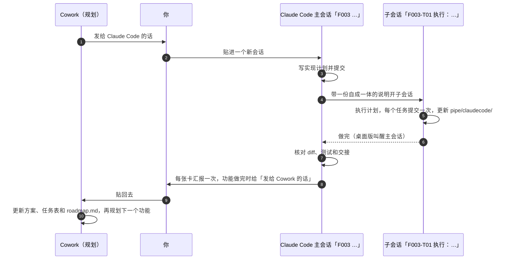

# claude-relay-loop

[English](README.md) | 简体中文

**一个让两层 Claude 分工协作的项目脚手架：Cowork 做规划，Claude Code 写实现，每个功能你在两边之间各转一段短话。**

> 社区项目，不是 Anthropic 出品，也没有得到 Anthropic 的认可或支持。Claude、Claude Code 和 Cowork 是 Anthropic 的产品。

## 为什么

AI 会话一长就会忘事。规划和写代码挤在同一个对话里，决定会被工具输出淹没。在不同工具之间来回复制上下文，又麻烦又容易漏。

claude-relay-loop 把工作拆开：

- **Cowork**（规划层）和你商量范围，写功能方案和任务卡，读实现结果。
- **Claude Code**（实现层）在**主会话**里把任务卡写成实现计划，在**子会话**里执行，核对过结果再向你汇报。
- **你**做决定，每个功能在两边之间各转一段话。

要紧的东西都在文件里（`pipe/`、`features/`、`roadmap.md`），所以任何一个会话都可以换成新会话，上下文不会丢。

## 循环



一个功能走一圈（`F001`、`F002`……）。会话标题都以 F 编号开头，所以同一个功能的主会话和子会话在侧边栏里挨在一起。

## 生成什么

```
my-project/
├── COWORK.md            # 规划层规则（每次开 Cowork 会话先说「读一下 COWORK.md」）
├── CLAUDE.md            # 实现层规则（Claude Code 自动加载）
├── roadmap.md           # 目标、用户、当前重点、接下来、以后再说
├── features/
│   ├── README.md        # F 编号，以及功能怎么组织
│   └── _template/plan.md
└── pipe/                # 交接区
    ├── README.md        # 交接怎么走，以及两种话的格式
    ├── cowork/          # latest.md（状态、任务表、任务卡）和 log/
    └── claudecode/      # latest.md、log/ 和 plans/
```

代码放在哪里都行。Cowork 只改规划文件；Claude Code 改代码和 `pipe/claudecode/`。

加 `--lang zh` 生成的就是上面这些文件的中文版，文件名不变。

## 需要什么

- **Claude 桌面版**，带 Cowork 和 Claude Code（Code 标签页）。从主会话开子会话需要桌面版。
- 用 **Claude Code CLI 或 IDE 插件**也可以：主会话把子会话的说明打印出来，你自己贴进第二个会话。
- `init.sh` 需要 `bash` 3.2 以上、`git` 和 `perl`。大多数 Linux 发行版都自带；macOS 上的 `git` 随命令行工具一起安装（`xcode-select --install`）。只有 `--auto-push` 需要 `jq`。
- 可选：Claude Code 的 superpowers 插件。装了的话，规则会用它的计划和执行技能；没装就用一份普通的计划骨架。

## 快速开始

```bash
git clone https://github.com/TwilightVoyager777/claude-relay-loop.git
claude-relay-loop/init.sh ~/code/my-project --lang zh --name "我的项目"
```

1. 用 Cowork 打开 `~/code/my-project`，说：**读一下 COWORK.md，带我开始**。
   Cowork 会问几个问题，写好 `roadmap.md`、第一个功能方案和第一张任务卡，请你提交，然后给你一段「发给 Claude Code 的话」。
2. 在 Claude 桌面版里对同一个文件夹打开 Code 标签页，新开一个会话，把这段话贴进去。
   这个会话会把自己改名为 `F001 …`，写计划，开子会话，再核对结果。
3. 功能做完后，它会给你一段「发给 Cowork 的话」。贴进 Cowork，循环就又开始了。

[docs/the-loop.zh-CN.md](docs/the-loop.zh-CN.md) 用一个功能把循环完整走一遍，每一步要贴的话都有示例。

### 已有的项目

对项目文件夹跑同样的命令。`init.sh` 从不覆盖文件：已经存在的文件（比如你自己的 `CLAUDE.md`）会被跳过，和脚手架里对应的那一份一起列出来，方便你手动合并。如果你的 `CLAUDE.md` 里还没有循环规则，`init.sh` 会提醒你：把规则复制进去，不然 Claude Code 不会照循环做。（它认的是 `<!-- relay-loop:rules -->` 这一行，复制时别漏了它。）可以先加 `--dry-run` 看看会发生什么。

## 选项

| 选项 | 作用 |
|---|---|
| `--name "我的项目"` | 生成的文件里用的项目名（默认用文件夹名） |
| `--lang zh` | 生成的文件用简体中文。默认是 `--lang en`，用英文。两种语言的文件名和结构一样 |
| `--team` | 加上团队包：给队友的共用 `CLAUDE.md`（分支 + pull request）、放你自己循环规则的 `CLAUDE.local.md`（不进 git）、给 Cowork 看的 `TEAM.md`、一份任务卡模板和一份 pull request 模板 |
| `--no-attribution` | 写一份 `.claude/settings.json`，关掉提交和 pull request 里的 AI 署名 |
| `--auto-push` | 加一个钩子：Claude Code 每次提交后，把当前分支 push 上去（需要 `jq`） |
| `--dry-run` | 只列出会新建和跳过哪些文件，什么都不写 |

更多见 [docs/customizing.zh-CN.md](docs/customizing.zh-CN.md)。

## 常见问题

**为什么不让 Cowork 和 Claude Code 直接对话？**
每次交接都经你的手，代价只是每个功能贴两段短话。文件才是依据，所以哪边的会话太长了，都可以随时换新会话。

**为什么要分主会话和子会话？**
写计划和执行计划都会产生大量上下文，分开之后谁也不挤占谁。主会话没写代码，核对结果时眼光是新的。而且子会话是一个真正的会话：你可以打开它，看它做，和它说话。

**一定要用 Cowork 吗？**
规则是照着 Cowork 写的。别的能读写项目文件夹的规划对话，也许也能照 `COWORK.md` 做，但实际用过的只有 Cowork。

**用什么语言？**
默认英文。加 `--lang zh`，生成的文件全是简体中文，文件名和结构不变。不管选哪种，两层都用你跟它们说话的语言回复；想让项目文件用第三种语言写，第一次会话时告诉 Cowork 就行。

**这是从哪来的？**
从一个真实项目里提炼出来的：一个小团队做了几个星期，这个循环是一个功能一个功能磨出来的。

## 许可证

[MIT](LICENSE)
